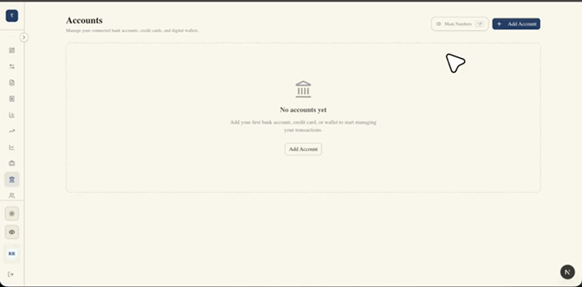
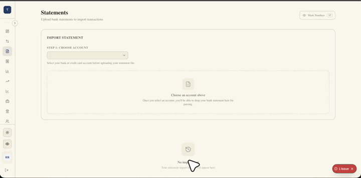
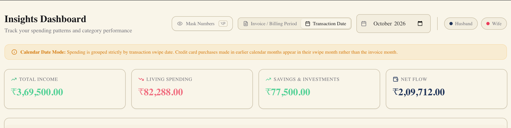
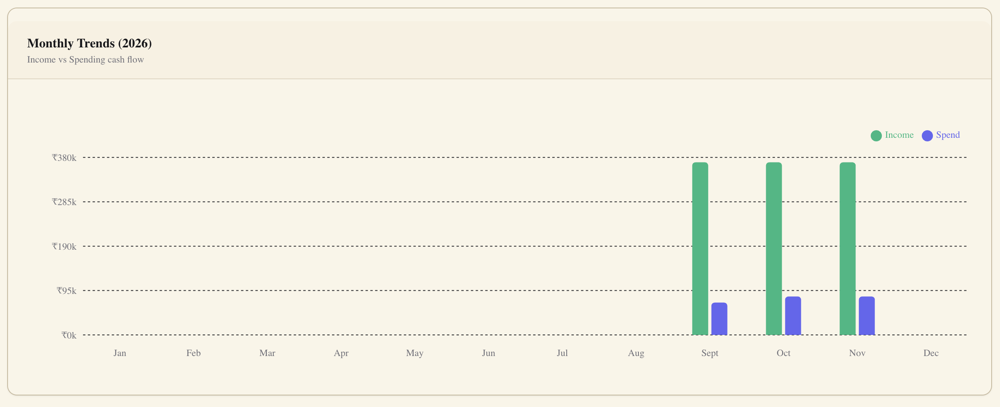
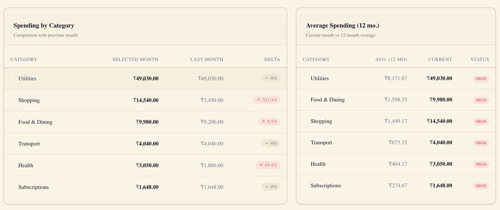
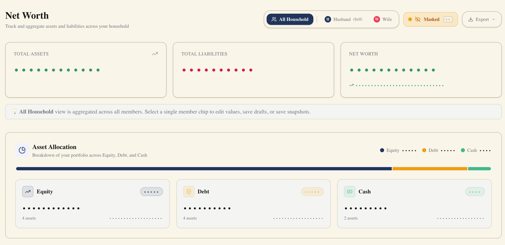
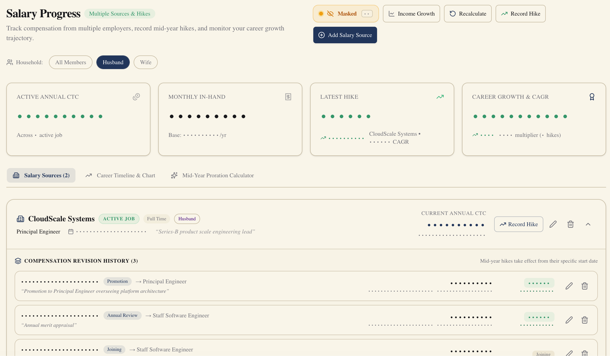
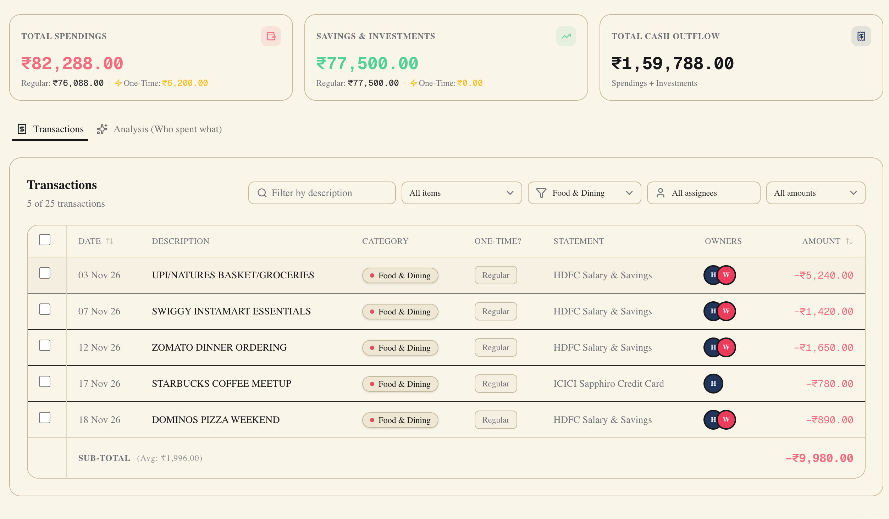
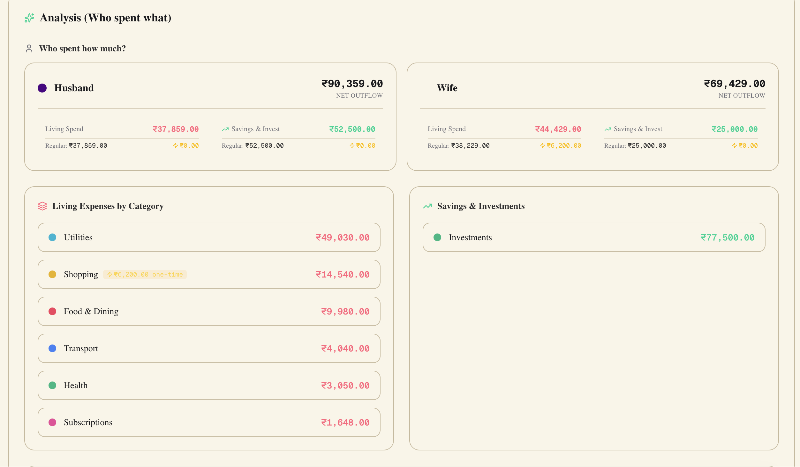
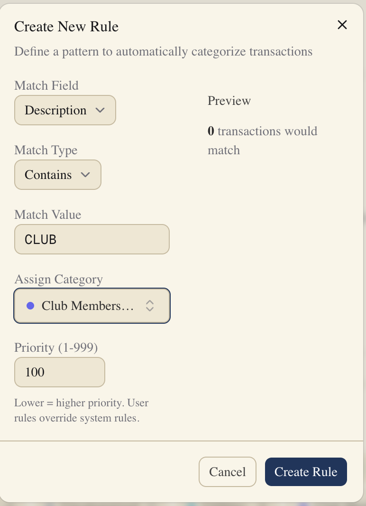

## Motivation

What is more difficult than figuring out where to invest? For me, it was planning to step-up and keeping track of investments.

Setting up my initial investment portfolio took me about a month of reading and some advice from friends and family. While I was happy ticking that off my box, I wasn't sure if I was over-investing or under-investing. Should I do an additional lumpsum investment with whatever I don't spend? What is a good factor to step up my investments by in the next year? What is my emergency fund?

More importantly, I wanted to be sure that a lifestyle creep does not derail my financial goals.

To address all of these questions, I started tracking my expeneses on Excel. I maintained one workbook per financial year, with a separate sheet for every month. I had one credit card and one debit account. Every month on the 5th, I would download my latest credit card and bank statements, combine them into a single spreadsheet, and categorize every transaction. A pivot table would help me understand how much money came and where money went.

This manual process of tracking expeneses was, for the lack of a better word, boring, but it worked. I had friends wanting to maintain a similar tracker but could not convince themselves to use Excel or Google Sheets and watch multiple small caged cells hold text, numbers and a random `#ERROR!` or `#N/A`.

## Introducing Wridhy

This is what eventually led me to build (or, should I say generated) Wridhy.

Wridhy is a personal finance tracker that parses your bank and credit card statements, automatically categorizes transactions and helps you understand where you spend your money. All without having to maintain multiple excel sheets.

Wridhy can help you do these tasks:

1. **Track Accounts & Transactions**: Add your bank accounts and credit cards, upload your statements to auto-categorize transactions
2. **Categorize Transactions**: Build custom rules based on merchants and transaction amounts.
3. **Understand spending patterns**: Explore category-wise spending for the last 12 months and understand how your expenses evovled with time
4. **Track hoseuhold networth**: Add household members and maintain a record of each member's networth
5. **Monitor Salary Growth**: Track salary changes over time to understand how salary progresses.
6. **Split household expenses**: If your household shares a common pool of expenses, generate monthly invoices by splitting category-wise payments across multiple members.

### Track Accounts

Basic book-keeping of the accounts that you hold. You can add put all your bank accounts & credit cards into a single view.

### Track Expenses

Upload your bank and credit card statements for a given month. Wridhy will auto-categorize transactions based on system and custom rules. You can also add new rules to customize your categorization.

With Excel, I found categorizaiton was a time taking activity. You could have a lookup table, write a few formulae and solve this, if you like Excel. Wridhy has [custom rules & categories](#custom-rules--categories) that does the look up and auto-categorization.

### Understand Spending Pattern

Wridhy computes a 12-month view of finances. You can see your monthly income, spending and savings pattern. The intention of a macro is to allow some room to spend. Tracking things monthly or daily, while possible, is demotivating.

The spending pattern view will probably be the least used view once financial discipline kicks in. But it is helpful to have a sense of if there is a lifestyle creep (or the opposite).

You can see the last 12 months of income v/s spending patterns

Wridhy also computes a "Spending by Category" table comparing the present month and last month and comparing category-wise spending with the 12-month average.

### Track Household Networth

Periodically tracking your networth helps you know your financial health. Can you retire? How long can you survive without an income? Can you buy that fancy car and still afford that month long trip?

Wridhy helps you keep track of your assets (mutual funds, stocks, FDs, RDs, Bonds, PPF, Real Estate), Liabilities (loans, credit card debt) and cash.

You can input this for every household member and compute this once every 6 months or so. Wridhy shows you an individual view as well as an aggregated view of net worth.

### Monitor Salary Growth

Salary or income is what _might_ fuel most of the income. Understanding how it grows is important to know if your income is beating inflation and helping you keep pace with your goals.

With Wridhy, you can track your salary growth during hikes, promotion and job switches to get a CAGR on how your income grew.

### Invoices

If your household splits bills, Wridhy can help you generate monthly invoices by splitting category-wise payments across multiple members. You can mark transactions as a one-time expense (e.g. if you buy a new washing machine) to keep a check on if there are lifestyle creeps.

Each Invoice gives you a summary of who spent what and where

### Custom Rules & Categories

Create your own category and build custom rules and Wridhy will auto-categorize transacitons when it parses your next statements.

## Next Steps

- Most of the UI is designed for testability. There are huge improvements to accessibility and usability that should be done.
- Few features maybe redundant (Income Tax Tracking v/s Income tracking) - needs ruthless consolidation
- The system is still **very** manual. An automation audit is due sometime to make it easier to use.
- The mobile experience is non-existent and needs a complete overhaul. (Maybe a chat-based UI that can integrate with a messaging app?)
